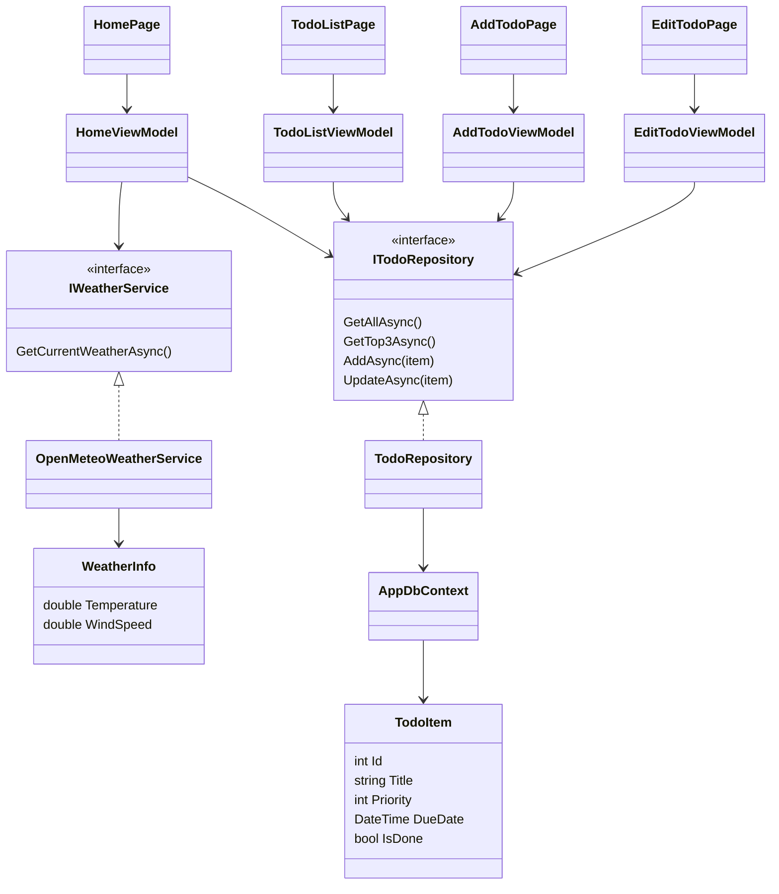

# LifeManagementApp

A .NET MAUI app that combines a to-do list with the current weather in Vaasa
and tells you when it is kitesurfing weather.

Author: Buthpitiya Lekamalage Yasodha Bandumali Buthpitiya - e2403004


Course: TT00BI73-3008 Client-Side Programming, VAMK

## Features

- **Home page:** top 3 unfinished to-dos (highest priority first, then earliest due date),
  current temperature and wind speed (m/s) from Open-Meteo, and a "🪁 Kitesurf weather!"
  alert when the wind is over 5 m/s. Shows a loading indicator and an error message if
  there is no network.
- **To-do page:** all to-dos in a list, sorting by priority or by due date, and a
  colour for each priority (converter).
- **Add page:** title, priority (1–5) and due date. An empty title cannot be saved.
- Data is stored in a local **SQLite** database with **EF Core Code First**.
- **Edit page:** tap a to-do in the list to edit it or mark it as done (parameter passing with Shell).

## How to run

1. Install Visual Studio 2022 with the ".NET Multi-platform App UI development" workload (.NET 9).
2. Clone the repository and open `LifeManagementApp.sln`.
3. Choose **Windows Machine** as the target and press ▶ Run.
4. The database file `todos.db` is created automatically on first start.

## Technologies

.NET 9 / .NET MAUI 9, XAML, CommunityToolkit.Mvvm, Entity Framework Core + SQLite,
HttpClient + System.Text.Json, dependency injection, Shell navigation.

## Project structure

```
LifeManagementApp/
├── Converters/   PriorityToColorConverter.cs
├── Data/         AppDbContext.cs
├── Models/       TodoItem.cs, WeatherInfo.cs, OpenMeteoResponse.cs
├── Services/     ITodoRepository.cs, TodoRepository.cs,
│                 IWeatherService.cs, OpenMeteoWeatherService.cs
├── ViewModels/   HomeViewModel.cs, TodoListViewModel.cs, AddTodoViewModel.cs, EditTodoViewModel.cs
├── Views/        HomePage, TodoListPage, AddTodoPage, EditTodoPage
├── AppShell.xaml   (tabs and routes)
└── MauiProgram.cs  (DI registrations)
```

## Class diagram



## Dependency injection lifetimes

| Service | Lifetime | Why |
|---|---|---|
| AppDbContext, TodoRepository | Singleton | One local database file, shared by the whole app |
| HttpClient, OpenMeteoWeatherService | Singleton | HttpClient should be reused, not created for every request |
| ViewModels and pages | Transient | Each page gets its own fresh ViewModel |

## AI use

I used Claude (AI assistant) as a tutor during the project: it explained the
requirements and concepts (MVVM, binding, DI, EF Core, HttpClient), suggested code
step by step, and helped me fix build errors. I typed the code into the project
myself, ran and tested every feature, and went through each part to understand
what it does and why.
